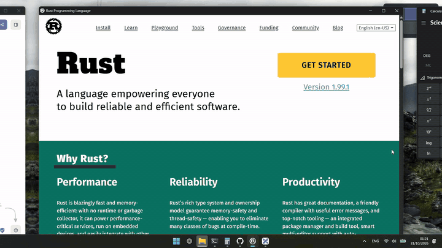

<h1 align="center">Apeiron</h1>

<p align="center">
  An infinite-canvas window manager for Windows.<br>
  Pan and zoom your desktop like a Figma board, where every object is a live app.
</p>

<p align="center">
  
  
  
  
</p>

<p align="center">
  
</p>

---

*Apeiron* is Greek for "the boundless". Your screen becomes a window onto an endless plane. Lay apps out side by side, glide between them with three fingers, zoom out to see everything at once.

## Gestures

| | |
|---|---|
| **Three-finger drag** | Pan, over any app |
| **Three-finger pinch** | Zoom around the cursor |
| **Two-finger scroll / pinch** | Pan / zoom on empty canvas |
| **Click a window** (zoomed out) | Fly to it |
| **Drag a window** (zoomed out) | Move it on the canvas; edges snap to neighbours (hold `Alt` to drag freely) |
| **Hover a window** (zoomed out) | Type into it without leaving the overview |
| **Esc** (zoomed out) | Back to where you started |

## Shortcuts

| | |
|---|---|
| `Ctrl` `Alt` `Z` | Overview: fit everything, or zoom back in |
| `Ctrl` `Alt` `F` | Find a window |
| `Ctrl` `Alt` `T` | Tidy up |
| `Ctrl` `Alt` `Q` | Quit |

## Features

- **Live everything.** Motion runs on GPU-composited DWM thumbnails, so apps keep rendering while you fly.
- **Wallpaper as the world.** Your wallpaper tiles endlessly and drifts behind windows with parallax. Or switch to a calm dot grid.
- **Minimap.** A live map in the corner. Click or drag it to travel.
- **Smart camera.** Flicks stop on the next window, landing frames the window you land on, pinches snap to fit a window or group, and zoomed-out pans settle on groups. Each one can be turned off in Settings.
- **Remembers your layout** between sessions.
- **Search, labels and tidy** for when the canvas gets crowded.
- **Tray icon, settings and autostart.**

## Install

```sh
git clone https://github.com/hectoragofi/apeiron
cd apeiron
cargo build --release
target\release\apeiron.exe
```

Then turn off Windows' own three-finger gestures:
**Settings › Bluetooth & devices › Touchpad › Three-finger gestures › Nothing**.
Four-finger gestures stay with Windows, so desktop switching still works.

## Safe by design

Apeiron only moves windows. It never changes your system. Anything parked off-screen comes back when you quit, when the app crashes, or when it's killed (a small watchdog process handles that). If all else fails:

```sh
apeiron rescue
```

Logs, settings and layout live in `%APPDATA%\Apeiron`.

## How it works

Windows can't scale real windows, and apps repaint late when moved. So Apeiron never animates them directly:

1. A gesture starts. A fullscreen overlay appears with a 1:1 live thumbnail of every window, indistinguishable from the desktop.
2. You pan and zoom. Only the thumbnails move, composited by DWM on the GPU.
3. You let go near 100% zoom. Real windows snap to where their thumbnails are and the overlay fades away.

An engine thread reads raw touchpad input and owns the canvas. A GPUI thread draws the backdrop, labels, minimap and search. Details in [`docs/PLAN.md`](docs/PLAN.md).

## Limits

- Primary monitor only, for now.
- Minimized windows aren't on the canvas.
- Elevated (admin) windows only move if Apeiron also runs as admin.

## License

[MIT](LICENSE)
